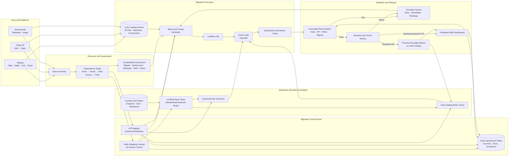
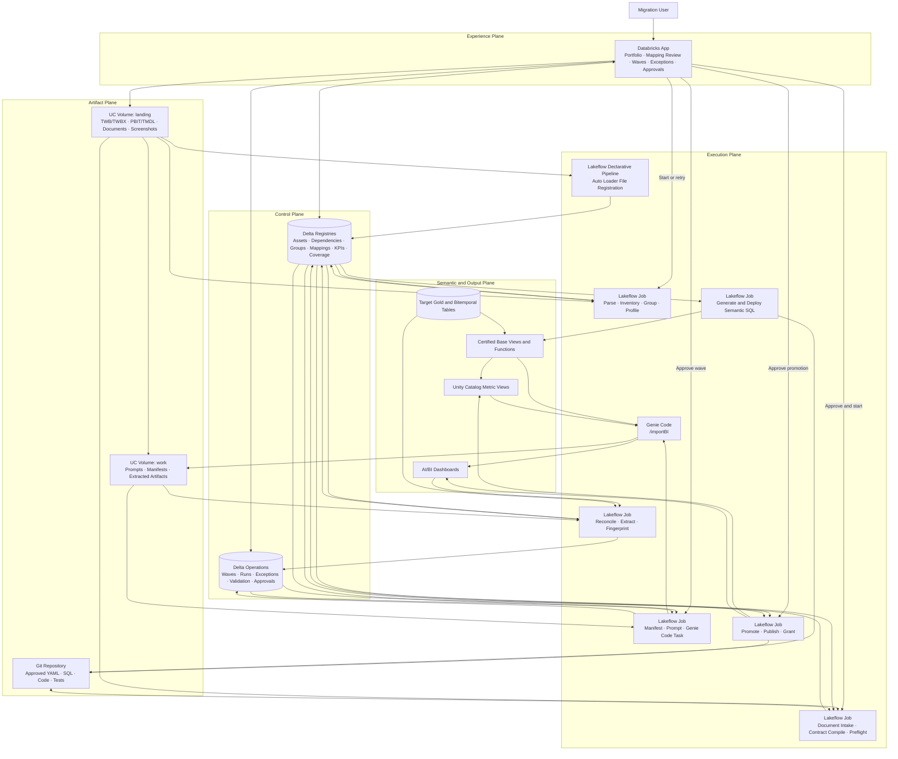

# BI Migration Blueprint

## 1. Purpose

Create a reusable solution for migrating Tableau and Power BI assets to Databricks AI/BI with Genie Code `/importBI`. The solution supports small pilots through enterprise portfolios and accounts for renamed fields, remodeled Gold data, optional temporal models, duplicated KPIs, and product capability gaps.

### Capital Group Pilot and Motivation

Capital Group ASQ `AR-000140897` is the pilot: approximately 6,500 users and 3,000 Tableau reports in a broader Synapse-to-Databricks migration. About 1,000 ad hoc reports are candidates for consolidation into governed metric views, reusable AI/BI dashboards, or Genie.

Pilot deliverables:

1. Profile dependencies, feature gaps, complexity, and consolidation candidates.
2. Define mappings and a governed semantic pattern for one domain.
3. Consolidate shared KPIs into Unity Catalog metric views.
4. Rebuild and validate 3–5 representative dashboards.
5. Test DBSQL serverless performance and concurrency.
6. Feed measured results into the reusable, platform-neutral solution package.

## 2. Deliverable

Deliver a **BI migration solution package** containing:

1. **Blueprint**
   - Architecture, workflow, decision gates, governance, and scale guidance.
2. **Genie Code instructions**
   - Versioned prompts for `/importBI`, mapping, retry, remediation, and validation.
   - Guardrails that prevent unresolved mappings or KPI changes from being guessed.
3. **Implementation assets**
   - Tableau and Power BI inventory extractors.
   - YAML mapping schema and examples.
   - Delta tables for inventory, mappings, KPIs, batches, runs, validation, and exceptions.
   - Standard base-view, optional temporal-view, and Unity Catalog metric-view templates.
   - Batch and prompt generators, reconciliation tests, and deployable DAB resources.
4. **Reference implementation**
   - A working pilot containing representative Tableau and Power BI assets, shared KPIs, applicable source-model patterns, and migrated AI/BI dashboards.
5. **Operations runbook**
   - Setup, execution, monitoring, retries, approvals, cutover, and legacy retirement.

The package is accepted when a new team can execute a pilot using the documented prerequisites, all mappings are machine-validated, canonical KPIs are reused, and migration results are traceable and tested.

## 3. Architecture



### Architecture Responsibilities

| Layer | Responsibility |
|---|---|
| Inventory | Extract BI assets, dependencies, calculations, KPIs, filters, and usage. |
| Mapping | Translate legacy sources, fields, values, calculations, and time semantics. |
| Semantic foundation | Hide physical, naming, grain, relationship, and optional temporal complexity behind certified business models. |
| KPI registry | Consolidate repeated KPI definitions and assign governed implementations. |
| Migration | Generate dashboards from controlled files, mappings, metric views, and prompts. |
| Validation | Separate expected data changes from mapping, semantic, or dashboard defects. |
| Operations | Track runs, retries, exceptions, approvals, cost, and rollout status. |

### Implementation Architecture

The solution has five explicit planes. The Databricks App is the user interface; it never performs long-running migration work inside the web process.



#### Component Boundaries

| Component | Owns | Does not own |
|---|---|---|
| Databricks App | User workflow, review, approvals, job submission, status, and exception remediation | Parsing large files, Spark processing, `/importBI`, SQL deployment, or validation execution |
| UC Volumes | Immutable inputs and generated file artifacts | Workflow state or approval decisions |
| Delta control tables | Current shared state, evidence, lineage, runs, exceptions, and approvals | Versioned source code or immutable reviewed contracts |
| Git and DABs | Code, schemas, approved YAML, SQL templates, tests, and deployment definitions | Live workflow state |
| Python wheel | Parsing, grouping, contract compilation, preflight, prompt generation, validation, and fingerprinting | Human approval or dashboard conversion |
| Lakeflow Jobs | Durable orchestration, task dependencies, retries, concurrency, and scheduled execution | Interactive review |
| Genie Code `/importBI` | Convert an approved workbook using prepared prompts, mappings, and semantic inputs | Portfolio inventory, approval, grouping, registry management, or final acceptance |
| Databricks SQL and Unity Catalog | Certified views, functions, metric views, reconciliation queries, and governance | Migration workflow orchestration |

#### End-to-End Control Flow

1. A user or source-system connector places BI files and existing mapping documents in the landing Volume.
2. Auto Loader registers new files; the discovery job parses them and updates inventory and dependency tables.
3. The grouping job assigns dashboards to semantic groups using shared tables, source relationships, grains, calculations, and reusable coverage fingerprints.
4. The mapping job extracts source relationships from BI metadata, inspects Unity Catalog metadata and profiling evidence, ingests existing mapping documents, and proposes target joins. It compiles fields and relationships into one YAML semantic contract and runs preflight.
5. The App shows only unresolved group decisions and dashboard-specific exceptions. Approved contracts are written to Delta and exported to Git.
6. The semantic-preparation job deploys certified base views, functions, and reusable metric views required by the group.
7. The App selects canaries and approves a migration wave. The import job freezes input versions, writes manifests and prompts, and invokes the Genie Code `/importBI` task.
8. The validation job reconciles data and KPIs, extracts generated local metric views, compares fingerprints, and creates exceptions or promotion candidates.
9. The App presents validation evidence. Approved dashboards are published; approved reusable metrics are promoted through a deployment job.
10. Every transition, input version, output identifier, decision, and retry is recorded in Delta operations tables.

## 4. Source Inventory and Grouping

Extract this dependency graph for each asset:

```text
dashboard/report -> page/worksheet -> visual -> datasource -> connection -> table
                                                            -> relationship -> table
```

- Parse Tableau `.twb` XML directly; unzip `.twbx` packages to inspect embedded `.twb`, `.tds`, and `.hyper` files.
- Parse Power BI `.pbit` and `.tmdl` model metadata, relationships, measures, and report dependencies.
- Export published Tableau `.tds` or `.tdsx` sources when they are not embedded.
- Capture custom SQL, joins, relationships, extracts, filters, parameters, LOD expressions, DAX measures, screenshots, owners, and usage.

Relationship discovery deliberately combines three evidence sources:

1. **BI intent:** extract physical joins and logical relationships, source keys, join types, calculations, and any cardinality hints from Tableau or Power BI metadata.
2. **Target feasibility:** inspect Unity Catalog tables, columns, declared constraints, comments, grains, and profiling statistics to propose target keys, cardinality, and duplicate risk.
3. **Business semantics:** ingest user mapping documents for authoritative table mappings, grains, keys, temporal rules, and exceptions that cannot be inferred safely from metadata.

The system must never infer bitemporal semantics from similarly named columns alone. As-of predicates, current-record filters, and effective-date anchors require mapping-document evidence or explicit approval. High-confidence deterministic translations may be proposed automatically; ambiguity is routed to relationship review.

Group assets into semantic-design waves using shared data sources, overlapping tables, cross-source relationships, common KPIs, and target Databricks domains. Assets that depend on multiple sources should be designed together so required base views and any already-governed metric views exist before `/importBI`; they do not have to run in the same import batch.

## 5. Mapping Contract

Use **YAML in Git** as the reviewable source of truth and load approved records into **Delta tables** for automation.

### Existing Mapping Document Intake

Users are not required to author the canonical YAML directly. Accept existing mapping evidence in Excel, CSV, Word, PDF, Markdown, Confluence exports, architecture diagrams, data dictionaries, SQL, dbt models, and source-to-target mapping tables.

The intake workflow must:

1. Preserve the original document in a Unity Catalog Volume.
2. Extract candidate table mappings, grains, keys, joins, fields, conversions, value mappings, KPI definitions, and temporal rules.
3. Record provenance for every candidate, including source file, page or sheet, row or section, extraction method, and confidence.
4. Merge document evidence with Tableau or Power BI metadata, target Unity Catalog metadata, profiling statistics, and previously approved mappings.
5. Surface contradictions, omissions, and low-confidence interpretations for review without overwriting approved decisions.
6. Compile reviewed decisions into the canonical YAML contract and validate it against the mapping schema.

Provide this as a mapping-document intake skill backed by a deterministic mapping-contract compiler. The skill interprets unstructured evidence; schemas, merge rules, validation, provenance, and contract generation remain deterministic.

The example below shows a bitemporal target. Snapshot sources omit `temporal_mode` and `temporal_rule`; other temporal models include only the fields they require.

```yaml
mapping_version: 1.0.0
domain: sales
status: approved

source:
  asset_platform: tableau
  table: synapse.dbo.fact_order
  grain: one row per order line

target:
  table: main.gold.order_bitemporal
  grain: one version per order line and validity interval
  modeling_type: bitemporal
  temporal_mode: current_truth
  temporal_rule:
    valid_from: business_valid_from
    valid_to: business_valid_to
    recorded_from: system_recorded_from
    recorded_to: system_recorded_to

relationships:
  - source:
      left_table: Orders
      right_table: Customers
      join_type: left
      condition: Orders.Customer_ID = Customers.Customer_ID
    target:
      left_table: main.gold.sales_order_line_bitemporal
      right_table: main.gold.customer_bitemporal
      join_type: left
      condition: sales.customer_id = customer.customer_id
      cardinality: many_to_one
      temporal_predicates:
        - sales.order_date >= customer.business_valid_from
        - sales.order_date < customer.business_valid_to
      record_filters:
        - customer.system_recorded_to IS NULL
    status: approved

fields:
  - legacy: Sales
    target_expression: net_sales_amount
    conversion: renamed
    aggregation: sum

kpis:
  - legacy_name: Gross Margin %
    canonical_name: gross_margin_rate
    target_expression: MEASURE(gross_profit) / NULLIF(MEASURE(net_sales), 0)
    metric_view: main.metrics.sales_performance
    tolerance: 0.001
```

Every mapping must define source and target grain, keys, modeling type, field conversions, value mappings, filters, KPI mappings, validation tolerance, owner, approval status, and asset-specific exceptions. Temporal rules are required only for sources modeled with SCD, valid-time, system-time, or bitemporal semantics.

Relationship entries are first-class approval objects rather than notes attached to fields. Each entry preserves the source relationship, proposed target tables and join condition, join type, cardinality, temporal predicates, current-record filters, duplicate-prevention behavior, evidence, confidence, and approval status. Field approval does not imply relationship approval.

Before import, the contract must also account for every referenced source field, datasource, relationship, calculation dependency, parameter, default date window, currency and unit, data type, and required value domain. It must distinguish mappings implemented directly on physical targets from mappings supplied by certified compatibility views. Join expressions must reference fields that exist in the declared source and target contexts, and temporal predicates must state whether they apply to fact validity, dimension as-of joins, recorded-time selection, or all three.

The contract may explicitly mark an item as `skipped`, `unsupported`, `redesign`, or `unresolved`, but it may not omit a referenced dependency silently. Only contracts with approved required mappings may proceed to dashboard creation.

### Import Readiness Preflight

Run a deterministic preflight before `/importBI` and produce a decision report covering:

- Mapping coverage for all referenced physical and calculated fields.
- Source and target grain coherence, including whether rows sharing an order or transaction key have consistent header attributes.
- Validity of join expressions and temporal selection rules.
- Availability of every datasource, including secondary sources such as returns or annotations.
- Parameter definitions, defaults, ranges, field-switcher behavior, and effective date windows against target data.
- Value-domain compatibility for segments, geography, product groupings, statuses, and other filtered dimensions.
- Type, unit, and currency compatibility.
- Unsupported Tableau or Power BI features and the approved skip, workaround, or redesign action.
- Contract approval status and unresolved decisions.

`/importBI` should receive the approved preflight report with the workbook, mapping contract, and migration manifest. It should not be expected to discover basic contract incompleteness after starting dashboard construction.

### Portfolio-Scale Review and Approval Inheritance

Do not repeat full mapping and semantic review for every dashboard. Inventory the portfolio first, then group assets by shared datasource, target tables, fact grain, relationships, temporal semantics, calculations, filters, and KPI fingerprints.

Resolve and approve reusable decisions once at the semantic-group or domain-and-grain level:

- Source-to-target table and field mappings.
- Join, key, grain, unit, currency, and value-translation rules.
- Temporal selection and as-of join rules.
- Canonical KPI definitions and approved variants.
- Certified base views and governed functions.
- Approved workarounds for recurring unsupported features.

Record these decisions in versioned registries with an explicit coverage signature. A dashboard may inherit approval only when its dependency fingerprint is within the declared coverage: referenced fields are mapped, source and target grain match, temporal meaning is compatible, required filters and value domains are supported, and KPI fingerprints match an approved definition.

Run preflight across the entire semantic group. Dashboards fully covered by approved rules proceed automatically; only new, conflicting, or asset-specific exceptions require human review. Reviewers approve the exception and either keep it asset-specific or promote it into the reusable domain contract for subsequent assets.

For each semantic group:

1. Select two or three representative canary dashboards covering the highest complexity and business importance.
2. Validate their data, KPIs, filters, interactions, and generated semantic objects end to end.
3. Freeze the approved mapping and semantic-foundation version for the wave.
4. Batch the remaining covered dashboards through `/importBI`.
5. Apply automated validation to every dashboard and risk-based business sampling to the batch.
6. Route only failures and uncovered fingerprints to the exception queue.

This changes the unit of full review from an individual dashboard to a reusable semantic group. Dashboard-level work is reserved for genuine exceptions, unique calculations, unsupported interactions, or business-specific redesign decisions.

In the App, mapping review is split into **Datasets and fields**, **Relationships and grain**, and **KPIs and parameters**. The relationship view shows source intent beside the proposed Databricks implementation and asks users only to resolve ambiguous target tables, keys, cardinality, or temporal behavior. Approval applies to the semantic group's coverage signature and is inherited by covered dashboards.

Recommended operational tables:

- `migration.asset_inventory`
- `migration.dependency_graph`
- `migration.mapping_registry`
- `migration.kpi_registry`
- `migration.metric_view_registry`
- `migration.batch_manifest`
- `migration.run_status`
- `migration.validation_result`
- `migration.exception_queue`

## 6. KPI and Semantic Design

1. Extract KPI occurrences from Tableau calculations and LOD expressions, Power BI DAX measures, custom SQL, filters, titles, and tooltips.
2. Group candidates by normalized formula, mapped fields, filters, aggregation order, time grain, and business meaning.
3. Have domain owners approve one canonical KPI or explicitly approved variants.
4. Build semantic objects by domain and fact grain, not by dashboard.

Use:

- **Certified base views** for renamed columns, resolved keys, stable grains, and temporal predicates when the source model requires them.
- **Metric views** for measures that re-aggregate correctly, including sums, counts, ratios of measures, supported windows, and distinct counts recomputed per query cell.
- **Governed SQL functions** for selection-dependent, iterative, parameterized, or non-reaggregatable calculations.

Use a hybrid metric-view lifecycle:

1. Before import, provide certified base views and reuse any existing approved UC metric views.
2. Let `/importBI` create dashboard-local metric views for newly migrated logic.
3. Validate local metric views against the source dashboard and target data.
4. Compare local definitions across dashboards and consolidate equivalent KPIs.
5. Promote approved, reusable definitions to Unity Catalog metric views.
6. Keep genuinely dashboard-specific logic local.

This local-first path uses `/importBI` for semantic discovery while preventing unvalidated or duplicate definitions from entering Unity Catalog.

### Central Metric-View Evaluation

Treat each generated local metric view as evidence, not as the unit of promotion. Extract and normalize its:

- Source tables, joins, fact grain, security, and temporal semantics.
- Dimensions, base measures, derived measures, filters, and parameters.
- Dashboard occurrences and source calculation lineage.

Generate fingerprints for the semantic model and each measure, then compare them with `metric_view_registry` and `kpi_registry`.

| Comparison | Action |
|---|---|
| Exact semantic and measure match | Reuse the existing centralized metric view. |
| Local model is a compatible subset | Map the dashboard to the existing centralized view. |
| New measure fits the same source and grain | Add it to the centralized domain metric view after validation. |
| Same KPI name but different formula or filters | Block promotion pending business-owner resolution. |
| Different grain, source, security, or temporal meaning | Create or select a separate centralized metric view. |
| Visualization-specific parameter or calculation | Keep it dashboard-local. |

Central metric views are organized by **business domain and fact grain**, not by dashboard or physical table. Promotion requires source and grain compatibility, correct re-aggregation, KPI and filter parity, dimension compatibility, security and temporal alignment, acceptable performance, and business approval.

The registry records canonical name, normalized formula, semantic fingerprint, source and grain, supported dimensions, dashboard occurrences, approval status, and target UC metric view. Later `/importBI` prompts reference approved registry entries so new dashboards reuse centralized definitions instead of creating another promoted duplicate.

## 7. Migration Workflow

Each stage consumes a defined input and produces the contract for the next stage:

| Stage | Inputs | Processing | Outputs / Next Input | Gate |
|---|---|---|---|---|
| 1. Ingest | Tableau or Power BI files, screenshots, usage metadata | Unpack and parse source artifacts | Raw source metadata in a UC Volume | Files are readable and complete |
| 2. Inventory | Raw source metadata | Extract assets, visuals, calculations, filters, fields, and relationships | `asset_inventory` and `dependency_graph` | Required dependencies are resolved |
| 3. Group | Dependency graph | Cluster assets by data source, tables, KPIs, domain, and cross-source dependency | Semantic-design groups and migration waves | Domain owner confirms grouping |
| 4. Draft mappings | Groups, source metadata, target catalog metadata, glossary, existing mapping documents | Mapping-document intake and `/extract-bi-mappings` normalize evidence and propose source-to-target matches | Domain YAML, provenance, asset exceptions, KPI candidates, unresolved mappings | No required mapping is silently guessed |
| 5. Approve mappings | Proposed YAML, unresolved report, and group dependency fingerprints | Data and business owners resolve reusable domain decisions and asset-specific exceptions | Approved versioned YAML and coverage signatures loaded into registries | Technical and business approval with explicit inheritance scope |
| 6. Prepare semantics | Approved mappings and KPI candidates | Create certified base views, reuse existing UC metric views, and build required governed functions | Import-ready data foundation and provisional `kpi_registry` | Data-access tests pass |
| 7. Assess assets | Inventory, compatibility matrix, approved semantics | Run group-wide import-readiness preflight, apply approval inheritance, and classify each asset | Approved migration manifest, coverage report, and exception queue | All referenced dependencies are covered or explicitly dispositioned |
| 8. Import | Migration manifest, BI files, screenshots, mappings, and data foundation | Validate canaries, freeze the wave version, then run `/importBI` for covered assets in batches of up to 100 files | Draft dashboards with local metric views, run metadata, and agent conversations | Import completes or enters exception queue |
| 9. Validate | Legacy baseline, target-equivalent queries, migrated dashboards, and local metric views | Test data, KPIs, filters, objects, performance, and visuals; compare metric definitions across assets | Validation results, promotion candidates, and exceptions | Automated and business acceptance |
| 10. Promote and publish | Approved dashboards, local metric views, and validation evidence | Promote reusable metrics to UC, retain local exceptions, publish, assign permissions, and document lineage | Production dashboards, governed metric views, and operational handoff | Release approval |

The mapping skill uses deterministic parsers for file extraction and schema validation. Genie Code proposes mappings; ambiguous matches are written as `unresolved`, not guessed. Approved domain YAML is reused across assets, while asset YAML contains exceptions only.

`/importBI` bulk inputs must be stored in a Unity Catalog volume. Genie Code Lakeflow Job tasks currently require configuration in the Jobs UI and run with auto-approval enabled; surrounding inventory, batching, tests, and deployments should remain deterministic and source-controlled.

### App CUJ Steps 4–5: Two Independently Retryable Jobs

After a semantic group's datasource mappings are approved, the App coordinates two group-scoped Lakeflow Jobs. Dashboard conversion and semantic-product construction have different runtimes, timeout risks, retry boundaries, and acceptance gates, so they must not share one Job run. The semantic-build Job does not rely on conversational memory from dashboard import; it reads persisted, versioned dashboard artifacts.

#### Step 4 — Dashboard Import Job

1. A deterministic notebook freezes the approved mapping YAML, workbook Volume paths, target namespaces, run ID, initiating user, and prompt version into a group migration manifest.
2. The notebook writes the `/importBI` prompt and all inputs to the group run directory in the UC Volume and records them in the workflow artifact registry.
3. Genie Code runs `/importBI` with the workbook paths and approved mapping contract. It creates draft AI/BI dashboards and records every skipped, degraded, or unresolved item instead of inventing data.
4. The import task must write the created dashboard IDs to `importbi-result.json`. A deterministic extraction notebook then calls the Lakeview Dashboard `get` API for every ID, stores the returned `serialized_dashboard` unchanged, and writes a normalized dashboard-config artifact containing datasets, `asset_name` or `queryLines`, dataset-level `columns` measures, widget queries and aggregate expressions, filters, parameters, pages, widgets, dashboard identifiers, and extraction timestamps. This API retrieval—not Genie Code conversation memory—is the authoritative handoff to Semantic Build.
5. The App shows Dashboard Import Job runs, batch progress, dashboard links, dashboard-config artifacts, and exceptions. Imports run in bounded batches, initially 5–10 workbooks, so large semantic groups do not depend on one long-running Genie Code task. Failed batches can be retried without rerunning inventory, mapping approval, successful batches, or semantic build.

Required Session 1 artifacts:

- `group-migration-manifest.json`
- `importbi-prompt.md`
- approved mapping YAML
- `importbi-result.json`
- `dashboard-config.json`
- `importbi-exceptions.json`

#### Step 5 — Semantic Build Job

1. A deterministic preflight verifies that `dashboard-config.json`, approved mappings, KPI inventory, target tables, and destination names are present and internally consistent.
2. A Genie Code task reads persisted dashboard configurations, approved mappings, and KPI inventory and creates only the candidate UC Metric View. It must not infer semantics solely from dashboard labels.
3. A deterministic notebook validates the Metric View type, YAML, source and join tables, dimensions, measures, formats, and representative `MEASURE()` queries. Failure blocks all downstream Agent work.
4. A second Genie Code task creates the Genie Agent using the validated Metric View as its only governed data source. The same task configures agent instructions, 5–8 visible sample questions, and the benchmark-question configuration.
5. Benchmark questions are registered with the Genie Agent for evaluation. They remain distinct from visible sample questions and ordinary conversational context, but they are part of the Agent's governed configuration and audit evidence.
6. A final audit task runs with `ALL_DONE`, verifies the validated Metric View, Genie Agent data source, sample questions, benchmark registration, and lineage, then writes a complete or incomplete audit result for the App.

Required Semantic Build artifacts:

- `semantic-preflight.json`
- `metric-view-proposal.yaml`
- `metric-view-validation.json`
- `genie-agent-result.json`
- `benchmark-set.json`
- `semantic-audit.json`

#### Lakeflow Job DAGs

```text
Dashboard Import Job
  freeze_group_package (notebook)
    -> import_dashboard (Genie Code, /importBI)
    -> extract_dashboard_config (notebook)
    -> audit_dashboard_import (notebook, ALL_DONE)

Semantic Build Job
  semantic_preflight (notebook)
    -> build_metric_view (Genie Code)
    -> validate_metric_view (notebook)
    -> build_genie_agent (Genie Code, includes benchmark configuration)
    -> audit_semantic_assets (notebook, ALL_DONE)
```

The production implementation follows the reviewed `genie-pbi-import-workflow` pattern for deterministic handoffs and validation. Genie Code Job tasks are currently configurable only in the Jobs UI; DABs, the Jobs API, and SDKs cannot define them. Therefore the bundle deploys UI-editable Jobs with clearly named placeholders, and an administrator performs the one-time supported UI configuration of the three Genie Code tasks. The App starts and monitors those configured Jobs and never requires users to open Genie Code for each group.

### Tooling by Stage

Use one primary implementation path per stage. Alternatives are retained only as future substitutions when scale or customer standards require them.

| Stage | Selected tooling | Implementation decision |
|---|---|---|
| 1. Ingest | Unity Catalog landing Volume, Auto Loader `binaryFile`, and scheduled Lakeflow Jobs using the Databricks SDK | Source APIs or users place artifacts in the Volume. Auto Loader incrementally registers new files into a Bronze Delta manifest using `availableNow`; it does not invoke `/importBI`. API acquisition remains a separate Python task so source credentials and retries are isolated. |
| 2. Inventory | Versioned `bi-migration` Python wheel in a Lakeflow Job, native ZIP/XML parsing, Tableau Hyper API, and Delta tables | Keep parsing deterministic and unit-testable outside notebooks. Write normalized inventory and dependency records to Delta. Add TMDL parsing to the same package when Power BI enters scope. |
| 3. Group | Spark SQL for edge construction plus NetworkX connected-components and similarity logic in the Python wheel | The expected portfolio is thousands, not millions, of dashboards; NetworkX is simpler to test and operate than GraphFrames. Store group membership, evidence, and algorithm version in Delta. |
| 4. Draft mappings | Python document adapters, Databricks AI Functions for unstructured extraction, `/extract-bi-mappings`, Pydantic, JSON Schema, and a deterministic contract compiler | Parse Excel and CSV deterministically. Use AI extraction only for prose or PDF evidence and retain citations and confidence. Genie Code interprets ambiguous business meaning; the compiler merges evidence and emits schema-valid YAML with unresolved items. |
| 5. Approve mappings | Databricks App backed by a SQL warehouse and Delta registries, with approved YAML exported to Git | The App is the reviewer interface and shows only exceptions. Delta provides shared workflow state and audit history; Git stores the immutable reviewed contract. Do not make reviewers edit YAML manually. |
| 6. Prepare semantics | SQL templates rendered by the Python wheel and deployed by DAB-managed Lakeflow Job SQL tasks | Generate certified base views and governed functions from approved contracts. Reuse existing UC metric views first. Keep SQL source-controlled and deployable; do not generate production semantics interactively in notebooks. |
| 7. Assess assets | Python preflight engine over Delta plus the same Databricks App for exceptions | Compute coverage signatures, compatibility decisions, approval inheritance, and migration manifests deterministically. Use an AI/BI dashboard only for portfolio reporting, not for workflow decisions. |
| 8. Import | UC Volume manifests and prompts, Lakeflow Jobs, and a Genie Code task configured in the Jobs UI to run `/importBI` | Use canary jobs first, then batches of covered assets. A Python orchestration task creates manifests, records run IDs, and routes failures. Keep the Genie Code task as the conversion worker rather than the control plane. |
| 9. Validate | Databricks SQL reconciliation queries, Python/pytest validation runner in Lakeflow Jobs, dashboard artifact extraction, and MLflow traces | Validate every dashboard automatically for data, KPI, filter, object, and semantic-definition parity. Use risk-based visual review for priority dashboards. Do not introduce dbt unless the customer already operates it. |
| 10. Promote and publish | Python wheel using Databricks SDK and dashboard APIs, source-controlled SQL deployed through DABs, Unity Catalog grants, and Delta registries | Normalize and fingerprint local metric views, promote approved reusable definitions to UC, publish dashboards, set permissions, and record lineage and release evidence. |

### Selected Platform Stack

- **Source control and deployment:** Git and Databricks Asset Bundles.
- **Deterministic implementation:** One tested Python wheel plus source-controlled SQL templates.
- **Orchestration:** Lakeflow Jobs; Lakeflow Spark Declarative Pipelines only for Auto Loader file registration where continuous incremental state is valuable.
- **Storage:** Unity Catalog Volumes for files and Delta tables for control-plane state, evidence, and results.
- **Human workflow:** One Databricks App for mapping approval, exceptions, canary sign-off, and promotion decisions.
- **Agentic work:** Genie Code skills for interpretation and remediation; `/importBI` for dashboard conversion.
- **Observability:** Delta run tables, Lakeflow Job task metadata, MLflow traces for agent activity, and an AI/BI operational dashboard.

Avoid a notebook-first implementation. Notebooks may support exploration and pilots, but production logic belongs in the Python wheel, SQL templates, jobs, schemas, and tests.

Use Genie Code for interpretation, mapping proposals, and dashboard generation. Use Python, SQL, schemas, tests, and deployment automation for repeatable extraction, validation, governance, and operations.

### Finalized import workspace and fan-out design

- New migrations use `/Volumes/<catalog>/<schema>/<volume>/bi-migrations/<user-defined-migration-slug>/`; `local-cuj` is legacy test output only.
- Original workbooks and mappings are stored once under `inputs/`; downstream artifacts reference them.
- Groups retain immutable `group-NNN` IDs internally, while storage and UI use readable slugs derived from datasource/domain evidence, workbook titles, and business entities.
- Dashboard Import runs `prepare_import`, a bounded-concurrency `For each` Genie Code task, then `reconcile_dashboards` with `ALL_DONE`.
- Each nested import adds a unique dashboard tag to the display name.
- Reconciliation discovers dashboards by tag and reads Lakeview configurations directly; it does not depend on Genie writing JSON.
- `semantic/` remains empty until reconciliation succeeds.

```text
bi-migrations/<migration-slug>/
  inputs/{workbooks,mappings}/
  control/{uploads.json,target-metadata.json}
  inventory/
  groups/<readable-group-slug>/
    group.json
    group-migration-manifest.json
    mapping/approved.yaml
    import/workbooks/<workbook-id>/{dashboard-config.json,result.json}
    import/summary.json
    semantic/
```

## 8. Compatibility and Decision Gates

Maintain a versioned compatibility matrix based on the migration-gap inventory:

- Source platform and construct.
- Native support, migration-tool support, workaround, roadmap, or unsupported status.
- Required Databricks Runtime or feature rollout stage.
- Fidelity impact and approved fallback.

Current gap themes include visualization, SQL/metric-view expressions, and dashboard interactivity. Common high-risk areas include Tableau LOD and context filters, parameter controls, table calculations, DAX filter-context functions, custom visuals, and measure-driven formatting.

Each asset receives one decision:

- **Migrate**: supported with accepted fidelity.
- **Migrate with workaround**: deterministic workaround is approved.
- **Redesign**: business outcome is preserved with a different experience.
- **Defer**: required capability is planned but unavailable.
- **Retire**: asset is unused, duplicated, or obsolete.

## 9. Validation

Validate every critical KPI against three results:

1. Legacy BI and legacy data-source value.
2. Databricks target-equivalent value using the approved mapping and, when applicable, temporal rule.
3. Migrated AI/BI dashboard value through the governed semantic layer.

Classify variances as expected source-data change, expected temporal-model effect, approved KPI change, mapping defect, semantic defect, dashboard defect, or unresolved exception.

Automate grain, key, dimension coverage, KPI parity, filter, and object-existence tests. Add temporal-overlap and temporal-selection tests only for applicable sources. Require business review for KPI meaning, applicable temporal interpretation, layout, interactions, and priority-dashboard screenshots.

Synthetic and pilot datasets must preserve the structural invariants used by the source dashboard. For example, all lines for an order must share the intended order-level customer and dates; filtered dimensions must include representative source values; parameter defaults must overlap available dates; and secondary datasources must exist or be explicitly removed from scope. Synthetic data that violates these invariants is useful only as a declared negative test.

### Development-Only Hyper Test Data Preparation

Hyper extraction is a development and evaluation utility, not part of the production migration package or runtime workflow. When packaged Tableau Hyper extracts are available in test assets, a development-only task extracts each readable Hyper table into an isolated, disposable Databricks test schema and records source table names, columns, Tableau-to-Spark type conversions, row counts, and content checksums. These fixtures support repeatable KPI and filter comparisons while production target data is unavailable.

Hyper-derived baseline tables must be tagged as test fixtures, excluded from production bundles, excluded from target-table discovery, and deleted or expired after the evaluation run. `/importBI` must never receive them as candidate production targets. Production validation uses customer-provided legacy baseline results or approved source-system extracts instead.

## 10. Delivery Phases

| Phase | Output |
|---|---|
| Mobilize | Scope, owners, environments, security, and success criteria. |
| Discover | Inventory, dependency graph, compatibility assessment, and Gold-model profile. |
| Standardize | Mapping schema, applicable temporal standards, KPI registry, and semantic conventions. |
| Build | Base views, existing governed semantics, operational tables, prompts, batching, and tests. |
| Pilot | Working reference migration with measured accuracy, effort, cost, and gaps. |
| Scale | Controlled migration waves, exception remediation, and operational reporting. |
| Cutover | Approval, publishing, legacy retirement, documentation, and support handoff. |

## 11. Immediate Next Steps

1. Build the dashboard-artifact extractor proven necessary by the Superstore `/importBI` test.
2. Add mapping-document intake with provenance and a deterministic compiler to the canonical YAML contract.
3. Add semantic-group dependency fingerprints, versioned coverage signatures, and approval-inheritance rules.
4. Add import-readiness preflight for complete field coverage, datasource availability, grain coherence, temporal joins, parameters, date ranges, value domains, types, units, currency, and unsupported features.
5. Add exception-only review and promotion of reusable exception decisions into domain contracts.
6. Correct the Superstore synthetic fixture so positive-test orders have coherent header attributes, representative Tableau value domains, compatible default dates, and a returns source; retain the current gaps as explicit negative-test cases.
7. Normalize embedded local metric views, parameters, measures, dimensions, and source expressions.
8. Add metric-definition comparison and promotion-candidate scoring across dashboards.
9. Add SQL reconciliation tests and screenshot-based review for priority assets.
10. Select 3–5 representative Capital Group dashboards as canaries and profile their source dependencies.
11. Run controlled `/importBI` pilots, freeze the approved wave version, and capture runtime, degradation, exceptions, and review effort.
12. Batch covered dashboards and route only uncovered fingerprints or validation failures to the exception queue.
13. Promote only validated, reusable definitions to the first governed domain metric view.
14. Test DBSQL serverless performance and concurrency.
