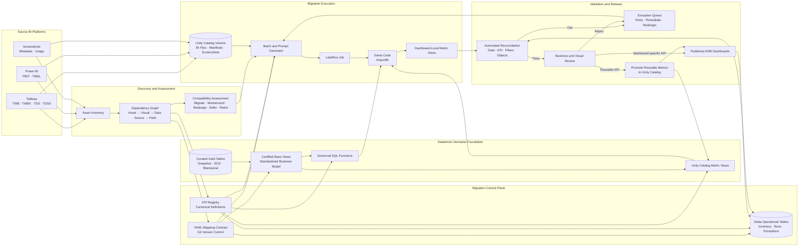

# BI Migration Blueprint

## 1. Purpose

Create a reusable solution for migrating Tableau and Power BI assets to Databricks AI/BI with Genie Code `/importBI`. The solution supports small pilots through enterprise portfolios and accounts for renamed fields, remodeled Gold data, optional temporal models, duplicated KPIs, and product capability gaps.

### Capital Group Pilot and Motivation

Capital Group ASQ `AR-000140897` is the pilot: approximately 6,500 users and 3,000 Tableau reports in a broader Synapse-to-Databricks migration. About 1,000 ad hoc reports are candidates for consolidation into governed metric views, reusable AI/BI dashboards, or Genie.

Pilot deliverables:

1. Profile dependencies, feature gaps, complexity, and consolidation candidates.
2. Define mappings and a governed semantic pattern for one domain.
3. Consolidate shared KPIs into Unity Catalog metric views.
4. Rebuild and validate 3–5 representative dashboards.
5. Test DBSQL serverless performance and concurrency.
6. Feed measured results into the reusable, platform-neutral solution package.

## 2. Deliverable

Deliver a **BI migration solution package** containing:

1. **Blueprint**
   - Architecture, workflow, decision gates, governance, and scale guidance.
2. **Genie Code instructions**
   - Versioned prompts for `/importBI`, mapping, retry, remediation, and validation.
   - Guardrails that prevent unresolved mappings or KPI changes from being guessed.
3. **Implementation assets**
   - Tableau and Power BI inventory extractors.
   - YAML mapping schema and examples.
   - Delta tables for inventory, mappings, KPIs, batches, runs, validation, and exceptions.
   - Standard base-view, optional temporal-view, and Unity Catalog metric-view templates.
   - Batch and prompt generators, reconciliation tests, and deployable DAB resources.
4. **Reference implementation**
   - A working pilot containing representative Tableau and Power BI assets, shared KPIs, applicable source-model patterns, and migrated AI/BI dashboards.
5. **Operations runbook**
   - Setup, execution, monitoring, retries, approvals, cutover, and legacy retirement.

The package is accepted when a new team can execute a pilot using the documented prerequisites, all mappings are machine-validated, canonical KPIs are reused, and migration results are traceable and tested.

## 3. Architecture



### Architecture Responsibilities

| Layer | Responsibility |
|---|---|
| Inventory | Extract BI assets, dependencies, calculations, KPIs, filters, and usage. |
| Mapping | Translate legacy sources, fields, values, calculations, and time semantics. |
| Semantic foundation | Hide physical, naming, grain, relationship, and optional temporal complexity behind certified business models. |
| KPI registry | Consolidate repeated KPI definitions and assign governed implementations. |
| Migration | Generate dashboards from controlled files, mappings, metric views, and prompts. |
| Validation | Separate expected data changes from mapping, semantic, or dashboard defects. |
| Operations | Track runs, retries, exceptions, approvals, cost, and rollout status. |

## 4. Source Inventory and Grouping

Extract this dependency graph for each asset:

```text
dashboard/report -> page/worksheet -> visual -> datasource -> connection -> table
```

- Parse Tableau `.twb` XML directly; unzip `.twbx` packages to inspect embedded `.twb`, `.tds`, and `.hyper` files.
- Parse Power BI `.pbit` and `.tmdl` model metadata, relationships, measures, and report dependencies.
- Export published Tableau `.tds` or `.tdsx` sources when they are not embedded.
- Capture custom SQL, joins, relationships, extracts, filters, parameters, LOD expressions, DAX measures, screenshots, owners, and usage.

Group assets into semantic-design waves using shared data sources, overlapping tables, cross-source relationships, common KPIs, and target Databricks domains. Assets that depend on multiple sources should be designed together so required base views and any already-governed metric views exist before `/importBI`; they do not have to run in the same import batch.

## 5. Mapping Contract

Use **YAML in Git** as the reviewable source of truth and load approved records into **Delta tables** for automation.

The example below shows a bitemporal target. Snapshot sources omit `temporal_mode` and `temporal_rule`; other temporal models include only the fields they require.

```yaml
mapping_version: 1.0.0
domain: sales
status: approved

source:
  asset_platform: tableau
  table: synapse.dbo.fact_order
  grain: one row per order line

target:
  table: main.gold.order_bitemporal
  grain: one version per order line and validity interval
  modeling_type: bitemporal
  temporal_mode: current_truth
  temporal_rule:
    valid_from: business_valid_from
    valid_to: business_valid_to
    recorded_from: system_recorded_from
    recorded_to: system_recorded_to

fields:
  - legacy: Sales
    target_expression: net_sales_amount
    conversion: renamed
    aggregation: sum

kpis:
  - legacy_name: Gross Margin %
    canonical_name: gross_margin_rate
    target_expression: MEASURE(gross_profit) / NULLIF(MEASURE(net_sales), 0)
    metric_view: main.metrics.sales_performance
    tolerance: 0.001
```

Every mapping must define source and target grain, keys, modeling type, field conversions, value mappings, filters, KPI mappings, validation tolerance, owner, approval status, and asset-specific exceptions. Temporal rules are required only for sources modeled with SCD, valid-time, system-time, or bitemporal semantics.

Recommended operational tables:

- `migration.asset_inventory`
- `migration.dependency_graph`
- `migration.mapping_registry`
- `migration.kpi_registry`
- `migration.metric_view_registry`
- `migration.batch_manifest`
- `migration.run_status`
- `migration.validation_result`
- `migration.exception_queue`

## 6. KPI and Semantic Design

1. Extract KPI occurrences from Tableau calculations and LOD expressions, Power BI DAX measures, custom SQL, filters, titles, and tooltips.
2. Group candidates by normalized formula, mapped fields, filters, aggregation order, time grain, and business meaning.
3. Have domain owners approve one canonical KPI or explicitly approved variants.
4. Build semantic objects by domain and fact grain, not by dashboard.

Use:

- **Certified base views** for renamed columns, resolved keys, stable grains, and temporal predicates when the source model requires them.
- **Metric views** for measures that re-aggregate correctly, including sums, counts, ratios of measures, supported windows, and distinct counts recomputed per query cell.
- **Governed SQL functions** for selection-dependent, iterative, parameterized, or non-reaggregatable calculations.

Use a hybrid metric-view lifecycle:

1. Before import, provide certified base views and reuse any existing approved UC metric views.
2. Let `/importBI` create dashboard-local metric views for newly migrated logic.
3. Validate local metric views against the source dashboard and target data.
4. Compare local definitions across dashboards and consolidate equivalent KPIs.
5. Promote approved, reusable definitions to Unity Catalog metric views.
6. Keep genuinely dashboard-specific logic local.

This local-first path uses `/importBI` for semantic discovery while preventing unvalidated or duplicate definitions from entering Unity Catalog.

### Central Metric-View Evaluation

Treat each generated local metric view as evidence, not as the unit of promotion. Extract and normalize its:

- Source tables, joins, fact grain, security, and temporal semantics.
- Dimensions, base measures, derived measures, filters, and parameters.
- Dashboard occurrences and source calculation lineage.

Generate fingerprints for the semantic model and each measure, then compare them with `metric_view_registry` and `kpi_registry`.

| Comparison | Action |
|---|---|
| Exact semantic and measure match | Reuse the existing centralized metric view. |
| Local model is a compatible subset | Map the dashboard to the existing centralized view. |
| New measure fits the same source and grain | Add it to the centralized domain metric view after validation. |
| Same KPI name but different formula or filters | Block promotion pending business-owner resolution. |
| Different grain, source, security, or temporal meaning | Create or select a separate centralized metric view. |
| Visualization-specific parameter or calculation | Keep it dashboard-local. |

Central metric views are organized by **business domain and fact grain**, not by dashboard or physical table. Promotion requires source and grain compatibility, correct re-aggregation, KPI and filter parity, dimension compatibility, security and temporal alignment, acceptable performance, and business approval.

The registry records canonical name, normalized formula, semantic fingerprint, source and grain, supported dimensions, dashboard occurrences, approval status, and target UC metric view. Later `/importBI` prompts reference approved registry entries so new dashboards reuse centralized definitions instead of creating another promoted duplicate.

## 7. Migration Workflow

Each stage consumes a defined input and produces the contract for the next stage:

| Stage | Inputs | Processing | Outputs / Next Input | Gate |
|---|---|---|---|---|
| 1. Ingest | Tableau or Power BI files, screenshots, usage metadata | Unpack and parse source artifacts | Raw source metadata in a UC Volume | Files are readable and complete |
| 2. Inventory | Raw source metadata | Extract assets, visuals, calculations, filters, fields, and relationships | `asset_inventory` and `dependency_graph` | Required dependencies are resolved |
| 3. Group | Dependency graph | Cluster assets by data source, tables, KPIs, domain, and cross-source dependency | Semantic-design groups and migration waves | Domain owner confirms grouping |
| 4. Draft mappings | Groups, source metadata, target catalog metadata, glossary, existing mappings | `/extract-bi-mappings` proposes source-to-target matches with confidence and evidence | Domain YAML, asset exceptions, KPI candidates, unresolved mappings | No required mapping is silently guessed |
| 5. Approve mappings | Proposed YAML and unresolved report | Data and business owners resolve grain, keys, fields, values, KPI, and applicable temporal rules | Approved versioned YAML loaded into `mapping_registry` | Technical and business approval |
| 6. Prepare semantics | Approved mappings and KPI candidates | Create certified base views, reuse existing UC metric views, and build required governed functions | Import-ready data foundation and provisional `kpi_registry` | Data-access tests pass |
| 7. Assess assets | Inventory, compatibility matrix, approved semantics | Classify each asset as migrate, workaround, redesign, defer, consolidate, or retire | Approved migration manifest | Product and business decision accepted |
| 8. Import | Migration manifest, BI files, screenshots, mappings, and data foundation | Generate prompts and run `/importBI` in batches of up to 100 files | Draft dashboards with local metric views, run metadata, and agent conversations | Import completes or enters exception queue |
| 9. Validate | Legacy baseline, target-equivalent queries, migrated dashboards, and local metric views | Test data, KPIs, filters, objects, performance, and visuals; compare metric definitions across assets | Validation results, promotion candidates, and exceptions | Automated and business acceptance |
| 10. Promote and publish | Approved dashboards, local metric views, and validation evidence | Promote reusable metrics to UC, retain local exceptions, publish, assign permissions, and document lineage | Production dashboards, governed metric views, and operational handoff | Release approval |

The mapping skill uses deterministic parsers for file extraction and schema validation. Genie Code proposes mappings; ambiguous matches are written as `unresolved`, not guessed. Approved domain YAML is reused across assets, while asset YAML contains exceptions only.

`/importBI` bulk inputs must be stored in a Unity Catalog volume. Genie Code Lakeflow Job tasks currently require configuration in the Jobs UI and run with auto-approval enabled; surrounding inventory, batching, tests, and deployments should remain deterministic and source-controlled.

### Tooling by Stage

| Stage | Recommended tooling |
|---|---|
| 1. Ingest | Tableau REST and Metadata APIs; Power BI REST and Scanner APIs; Databricks SDK/CLI; Unity Catalog Volumes. |
| 2. Inventory | Python parsers for XML and ZIP; Tableau Hyper API; TMDL metadata parser; Spark and Delta tables. |
| 3. Group | Databricks SQL/Spark over the dependency graph; deterministic similarity rules; GraphFrames or NetworkX when graph clustering is needed. |
| 4. Draft mappings | Custom Genie Code `/extract-bi-mappings` skill; Unity Catalog metadata; data profiling queries; YAML, JSON Schema, and Pydantic validation. |
| 5. Approve mappings | Git pull requests for YAML; a lightweight Databricks App for reviewer decisions; Delta mapping registry for approved records. |
| 6. Prepare semantics | Certified SQL views; existing Unity Catalog metric views; governed SQL functions; DAB-managed SQL deployment jobs. |
| 7. Assess assets | Delta compatibility matrix; rule-based scoring notebook or Python package; Databricks App or AI/BI dashboard for portfolio review. |
| 8. Import | Manifest and prompt generator; UC Volumes; Lakeflow Jobs; Genie Code task configured in the Jobs UI; `/importBI`. |
| 9. Validate | Databricks SQL reconciliation queries; pytest or dbt tests; MLflow traces for agent runs; screenshot comparison for priority dashboards. |
| 10. Promote and publish | Local-to-UC metric-view promotion; AI/BI Dashboard APIs/SDK; Unity Catalog permissions; DABs for supported resources; operational dashboard and runbook. |

Use Genie Code for interpretation, mapping proposals, and dashboard generation. Use Python, SQL, schemas, tests, and deployment automation for repeatable extraction, validation, governance, and operations.

## 8. Compatibility and Decision Gates

Maintain a versioned compatibility matrix based on the migration-gap inventory:

- Source platform and construct.
- Native support, migration-tool support, workaround, roadmap, or unsupported status.
- Required Databricks Runtime or feature rollout stage.
- Fidelity impact and approved fallback.

Current gap themes include visualization, SQL/metric-view expressions, and dashboard interactivity. Common high-risk areas include Tableau LOD and context filters, parameter controls, table calculations, DAX filter-context functions, custom visuals, and measure-driven formatting.

Each asset receives one decision:

- **Migrate**: supported with accepted fidelity.
- **Migrate with workaround**: deterministic workaround is approved.
- **Redesign**: business outcome is preserved with a different experience.
- **Defer**: required capability is planned but unavailable.
- **Retire**: asset is unused, duplicated, or obsolete.

## 9. Validation

Validate every critical KPI against three results:

1. Legacy BI and legacy data-source value.
2. Databricks target-equivalent value using the approved mapping and, when applicable, temporal rule.
3. Migrated AI/BI dashboard value through the governed semantic layer.

Classify variances as expected source-data change, expected temporal-model effect, approved KPI change, mapping defect, semantic defect, dashboard defect, or unresolved exception.

Automate grain, key, dimension coverage, KPI parity, filter, and object-existence tests. Add temporal-overlap and temporal-selection tests only for applicable sources. Require business review for KPI meaning, applicable temporal interpretation, layout, interactions, and priority-dashboard screenshots.

## 10. Delivery Phases

| Phase | Output |
|---|---|
| Mobilize | Scope, owners, environments, security, and success criteria. |
| Discover | Inventory, dependency graph, compatibility assessment, and Gold-model profile. |
| Standardize | Mapping schema, applicable temporal standards, KPI registry, and semantic conventions. |
| Build | Base views, existing governed semantics, operational tables, prompts, batching, and tests. |
| Pilot | Working reference migration with measured accuracy, effort, cost, and gaps. |
| Scale | Controlled migration waves, exception remediation, and operational reporting. |
| Cutover | Approval, publishing, legacy retirement, documentation, and support handoff. |

## 11. Immediate Next Steps

1. Build the dashboard-artifact extractor proven necessary by the Superstore `/importBI` test.
2. Normalize embedded local metric views, parameters, measures, dimensions, and source expressions.
3. Add metric-definition comparison and promotion-candidate scoring across dashboards.
4. Add SQL reconciliation tests and screenshot-based review for priority assets.
5. Select 3–5 representative Capital Group dashboards and profile their source dependencies.
6. Run controlled `/importBI` pilots and capture runtime, degradation, exceptions, and review effort.
7. Promote only validated, reusable definitions to the first governed domain metric view.
8. Test DBSQL serverless performance and concurrency.
